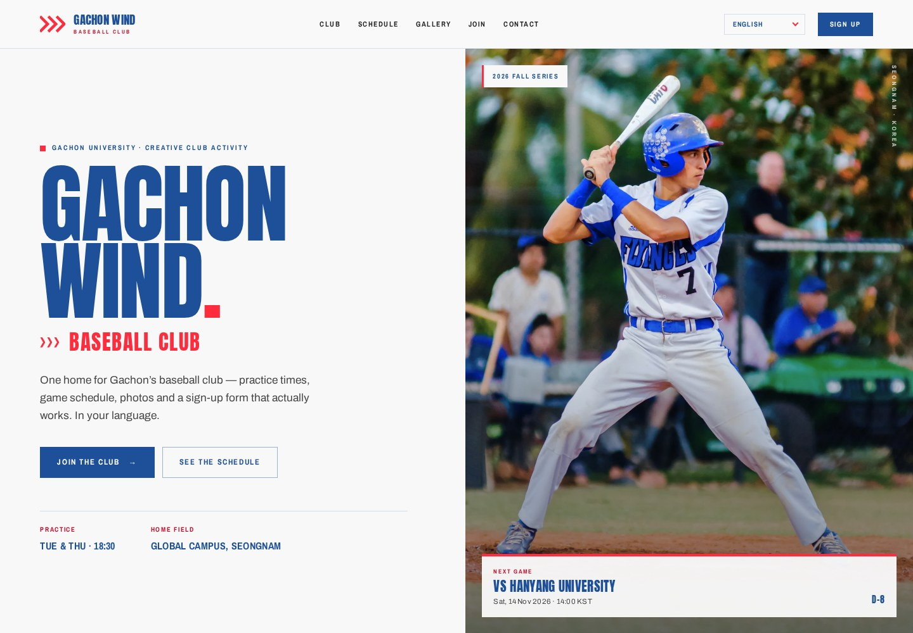
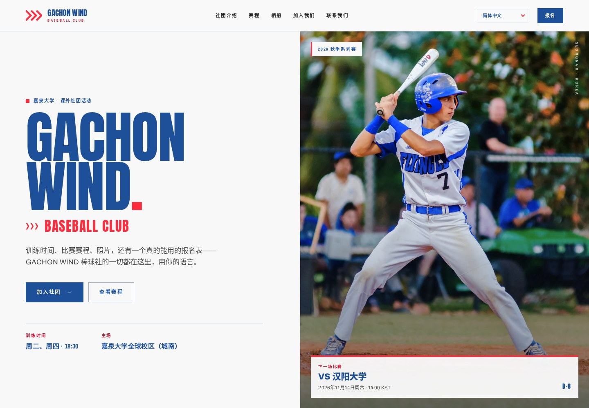

# GACHON WIND — Baseball Club Homepage

A responsive, multilingual homepage for **GACHON WIND**, Gachon University's student-run baseball club, built from the visual language of Team 16's proposal deck.



*The same page in Simplified Chinese:*



---

## What's on the page

| Section | What it does |
| --- | --- |
| Sticky header | Section navigation, language dropdown (English · 한국어 · Tiếng Việt · 日本語 · 简体中文), dark/light theme toggle, sign-up CTA, mobile drawer |
| Hero | Brand lockup, practice details, primary CTAs, live “next game” card with D-day countdown |
| Ticker | Club wordmark marquee, pausable on hover |
| The club | Club profile, stats, three activity cards, home-field photo |
| Fixtures | Next game panel (countdown + **.ics download**), upcoming-game list built from data |
| Why it's better | The proposal's three promises — always current, easy to join, truly accessible |
| Gallery | Four-photo editorial grid with keyboard-accessible lightbox and Instagram strip |
| Sign up | Three joining steps and an in-page application form (EN/KO/VI/JA) |
| Contact | Email, Instagram, KakaoTalk, practice address and a map link |
| Footer | Navigation, credits, oversized outlined wordmark |

The nav links point to sections on this page, so nothing dead-ends — the start of the deck's “no broken links” promise. The separate schedule, gallery and form pages from the proposal can be layered on later without changing this shell.

---

## Theme taken from the deck

| Token | Value | Use |
| --- | --- | --- |
| Paper | `#F8F8F8` | Page background |
| Royal blue | `#1E509A` | Display type, primary actions, panels |
| Signal red | `#FF2C3E` | Accents, chevrons, numbers, highlights |
| Deep red | `#C8102E` | Small red text on light backgrounds (accessible variant) |
| Ink | `#262626` | Body copy |

- **Display type:** [Anton](https://fonts.google.com/specimen/Anton), used the way the deck uses its condensed caps — huge, uppercase, tightly set, with alternating blue/red lines.
- **Body:** [Archivo](https://fonts.google.com/specimen/Archivo); **labels/kickers:** [Archivo Narrow](https://fonts.google.com/specimen/Archivo+Narrow).
- **Motifs:** red triple-chevrons, thin rules with solid red chevron markers, full-bleed baseball photography, oversized numerals, and a red full stop after big headings.
- Fonts are self-hosted in `static/fonts/` (SIL Open Font License), so the page works offline.

---

## Features

- **Five languages** — English, Korean, Vietnamese, Japanese and Simplified Chinese, switchable at any time from a dropdown. The choice is remembered, and the page title, dates, schedule, fixture names and form all follow it. Korean, Japanese and Chinese headings use a heavy CJK fallback because Anton has no Hangul, Kana or Han glyphs.
- **Dark · light switcher** — a moon/sun button in the header (and in the mobile drawer) flips the whole palette: paper becomes night blue, royal blue lifts to a more saturated azure for display type, and the deep panels stay dark. The choice is remembered in `localStorage`; first-time visitors get their OS `prefers-color-scheme`, kept in sync until they toggle. A tiny inline script applies the theme before first paint, so there is no flash of the wrong theme, and the mobile browser chrome colour follows via `<meta name="theme-color">`. The flip itself cross-fades: the colour tokens are registered with `@property` and `<html>` transitions them on a non-linear ease-in-out curve, so the page glides like a dimmer rather than snapping, and the toggle's moon/sun glyphs trade places on the same curve — a quarter-turn carousel spin instead of a hard cut (all instant under `prefers-reduced-motion`).
- **Live next-game countdown** — reads the fixture list, promotes the next future game, and hides itself when the season is over.
- **Calendar download** — generates a valid `.ics` event (KST times converted to UTC) for the next fixture.
- **Sign-up form** — client-side validation, translated errors and ARIA states. It assembles an application and hands it to the club's email (nothing is silently stored or “sent”). Users can copy the details instead.
- **Gallery lightbox** — arrow-key navigation, captions, counter, focus trap, Escape to close.
- **Mobile drawer** — full-screen menu with practice details and the language dropdown; background content is made `inert` while it is open.
- **Motion with respect** — reveal-on-scroll, marquee and hover effects all collapse under `prefers-reduced-motion`.
- **Accessible by default** — skip link, visible focus rings, labelled controls, `aria-expanded`/`aria-pressed` states, contrast-checked palette, and zero axe WCAG A/AA violations.

---

## Accessibility & QA

Checked in headless Chromium at 1440, 800 and 390 px, plus the open dialog, lightbox and mobile menu:

- **axe-core WCAG A/AA:** 0 violations in every state and viewport (1 “incomplete” item relates to text over the hero photograph).
- **59/59 functional checks:** image decoding, no horizontal overflow at four widths, HTML integrity (duplicate IDs, anchors, alt text, label targets), all five languages (page, title, nav, headings, fixture names, form copy), dropdown sync + persistence, form validation and submission, lightbox keyboard flow, `.ics` contents, mobile menu state, zero console errors.
- **Keyboard:** skip link, focus-visible rings, native `<dialog>` focus handling, manual lightbox focus trap, Escape behaviour, `inert` background while the mobile menu is open.
- **Motion:** all animation is disabled under `prefers-reduced-motion`.
- **Dark theme:** the same checks were replayed with `data-theme="dark"`; every token pair was re-contrast-checked (accents lift lighter, panels stay dark, `--paper` keeps white text on panels in both themes).

> Preview screenshots in `preview/` were generated at 1440 × 1000 and 390 × 844. The Chinese preview shows the same page with `简体中文` selected.

---

## Project structure

```
gachon-wind/
├── index.html
├── css/
│   └── style.css
├── js/
│   ├── i18n.js              # 4 language dictionaries + locale metadata
│   └── main.js              # schedule, countdown, lightbox, form, menu, i18n runtime
├── static/
│   ├── fonts/               # self-hosted Anton / Archivo / Archivo Narrow
│   ├── img/                 # WebP photography
│   └── favicon.svg
├── preview/                # screenshots used in this README
└── README.md
```

---

## Credits

**Team 16 · Web Programming**

- Ooi Yong Wee — schedule and events
- Jasper Teo Kheng Cher — sign-up application form
- Wong Deng Foong — multilingual support
- Wong Guan Qi Ryan — homepage and club info

Built as a single static homepage for the proposal. Fonts: Anton, Archivo and Archivo Narrow via Google Fonts (SIL OFL 1.1). Photography from the team's proposal deck.
